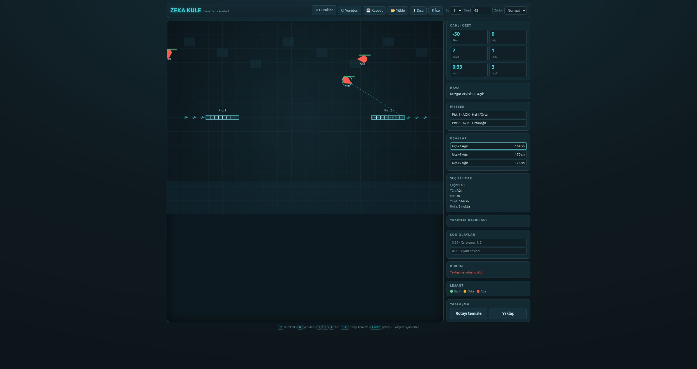

# zeka kule ✈️

Qwen3.8’e yönlendirmeyle yazdırılmış hava trafik kontrol oyunu.

[Oyna](https://zekayapar.github.io/qwen-hava-kontrol/) · [Geliştirme yazısı](https://zekayapar.com/yazi/qwen-hava-kontrol) · [Tam ölçüm ve hata kaydı](benchmark/RESULTS.md)

Uçağı seçip rotasını çiz, doğru pistin yaklaşma oku yönünde indir. İki pist, üç uçak türü, yakıt, yakınlık ve çarpışma, seedli trafik, fırtına, kayıt/yükleme ve JSON aktarımı var. P ile duraklat, 1/2/4 ile hızı değiştir. Mobilde dokunarak rota çiz.

Oyunun HTML/CSS’i, simülasyon motoru ve kontrollerini Qwen üretti. Codex kapsamı, promptları, inceleme geri bildirimlerini, test ve ölçüm araçlarını, grafikleri ve entegrasyonu hazırladı. Küçük yamalarda kesin mantık yönlendirmesi de verildi; bağımsız geliştirme iddiası yok.

Bütün promptlar ve yanıtlar, kesilen ve hatalı turlar dahil `benchmark/` içinde. **13 istek denemesi, 12 kullanım bildiren yanıt, 78.022 token, 231,2 saniye model HTTP süresi.** Final 45 kontrol geçti. Bu, tek projenin geliştirme kaydı; genel kalite veya hız garantisi değil.

Yerel çalıştırma: `python3 -m http.server 18083 --bind 127.0.0.1`. Aç: http://127.0.0.1:18083 . ES modülleri için HTTP gerekir.

Node 22+ ile test: `node --test tools/engine.test.mjs tools/review.test.mjs tools/ui.test.mjs`.

Oyun çalışırken AI/API bağlantısı veya harici bağımlılık gerektirmez. MIT lisansı.
