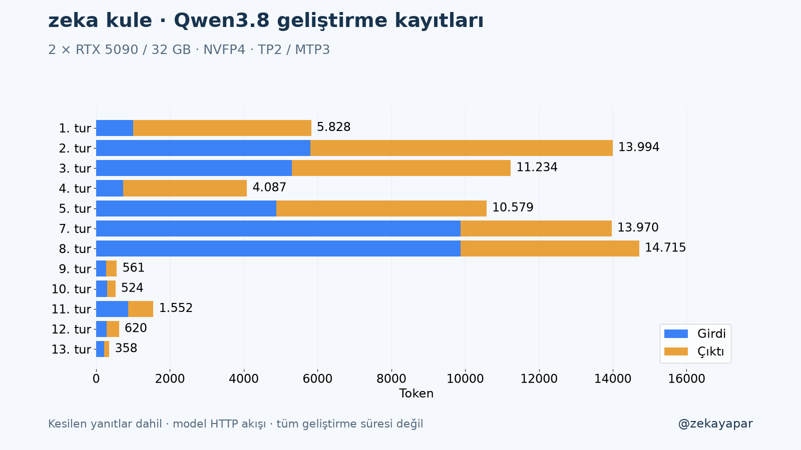
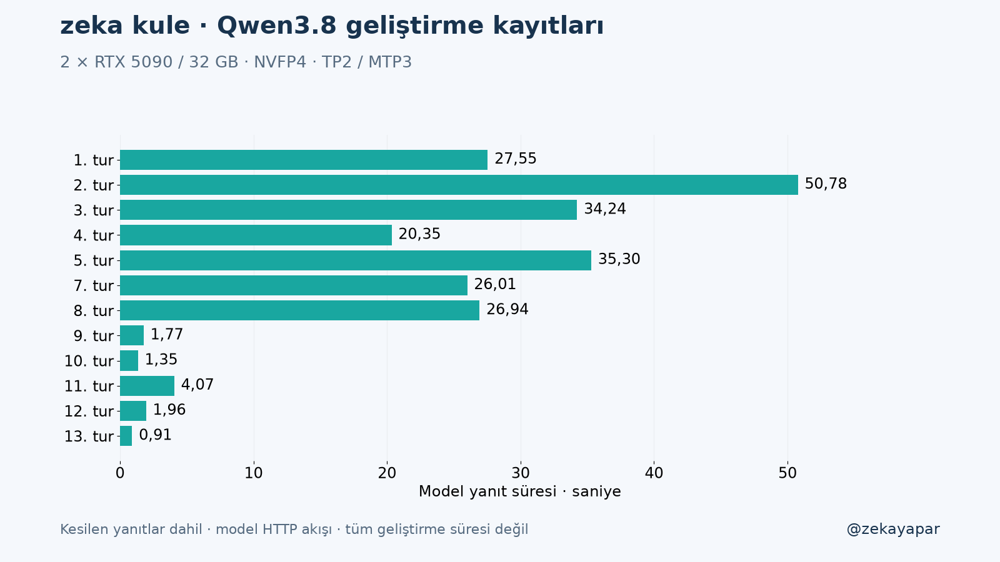
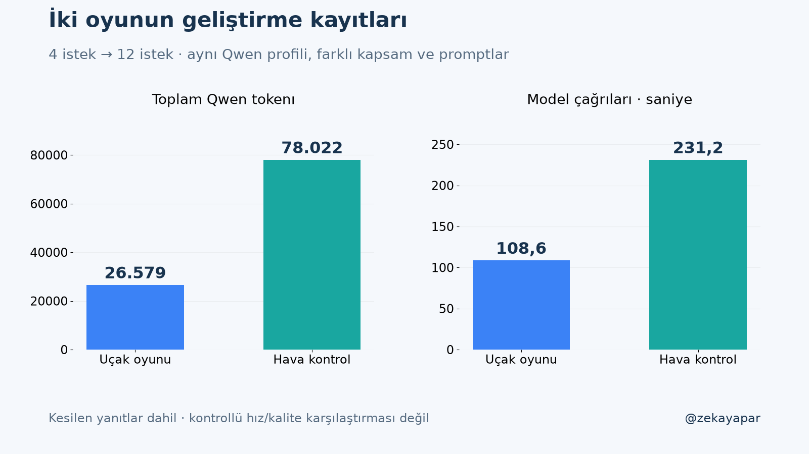

# zeka kule — yönlendirilmiş Qwen geliştirme kaydı

13 Ekim2026. HTML/CSS, engine.js simülasyonu ve app.js kontrolleri yerel Qwen3.8 tarafından üretildi. Codex kapsam/API sözleşmesi, promptlar, geri bildirimler, testler, kayıt/yama uygulama araçları, grafikler, repo ve siteyazısını hazırladı. Küçük yamalarda kesin mantık ve konum yönlendirmesi verildi; Qwen tekbaşına/bağımsız geliştirdi iddiası yok. Oyun kodu elle tamamlanmadı; tüm değişiklikler kaydedilmiş modelyanıtlarından alındı.

## Kapsam

1000×700 radar, iki pist ve tür/yön uyumu, pist doluluğu, hafif/orta/ağır uçaklar, rota çizme ve yaklaşma yardımcısı, yakıt, yakınlık/çarpışma, seedli trafik, normal/zor, fırtına/pist kapanışı,1×/2×/4×hız, pause/focus,localStoragekayıt ve JSONiçe/dışa aktarma. Gerçek havacılık simülasyonu değil. Rüzgar değeri gerçek fizik modeli değil; fırtına pist kullanılabilirliğini etkiler.

## Bütün denemeler

| Tur | Girdi | Çıktı | Toplam | İlk içerik ms | HTTP sn | Bitiş |
|---|---:|---:|---:|---:|---:|---|
| 01-engine | 1005 | 4823 | 5828 | 345.307 | 27.546 | stop |
| 02-interface | 5802 | 8192 | 13994 | 1944.400 | 50.779 | length |
| 03-engine-review | 5298 | 5936 | 11234 | 1805.003 | 34.241 | stop |
| 04-layout | 726 | 3361 | 4087 | 273.451 | 20.348 | stop |
| 05-controller | 4881 | 5698 | 10579 | 1659.390 | 35.301 | stop |
| 07-integration-fixes | 9874 | 4096 | 13970 | 3572.580 | 26.011 | length |
| 08-integration-fixes | 9874 | 4841 | 14715 | 435.320 | 26.936 | stop |
| 09-final-patch | 265 | 296 | 561 | 163.554 | 1.773 | stop |
| 10-syntax-fix | 304 | 220 | 524 | 164.265 | 1.346 | stop |
| 11-load-functions | 863 | 689 | 1552 | 329.418 | 4.068 | stop |
| 12-speed-reset | 285 | 335 | 620 | 154.249 | 1.955 | stop |
| 13-animation-fix | 222 | 136 | 358 | 161.097 | 0.912 | stop |

06-integration-fixes ayrıca HTTP400 ile reddedildi. Kullanım/süre raporlanmadı ve ilk hata gövdesi yakalanmadı; birleşik tamdosya girdisi+çıktıbütçesi bağlamı aşmış olması request'ten çıkarımdır, ölçülen hata gövdesi değil. request.json ve error.json korunur. Toplam13deneme,12usagebildirilenyanıt. Kesilen02/07yanıtları kullanıma dahildir.

## Hatalar ve düzeltmeler

- 01motor:24öncedenyazılantest23geçti. Aynıkonumdaki ilkwaypoint tüketilip kalanmesafe kullanılmıyordu.8sonradanreviewtest0/8:PRNGstate ilerlememesi,çokluçarpışmasayımı ve savevalidasyonu.
- 02tamUI8192çıktıda kesildi; kullanılmadı. HTML/CSSvecontroller ayrıisteklere bölündü.
- 03motorfix32/32geçti. Sonradanfırtınabitişisave testi eklendi; negatifstormTimerhatası bulundu.
- 04shell ve05controller üretildi.10UItesti0/10; bazıları aynıbaşlangıçpausedhatasına bağlı,10bağımsızhata demekdeğil.
- 06HTTP400;07JSONyama4096tokenda kesildi; uygulanmadı.
- 08yama22değişiklik. İlk43test35/43 çıktısının8hatası CodexVMmock'ta document.querySelector eksikliğiydi; harnessdüzeltildi. Gerçek41/43, loadhız ve busy-pistyardımcısı kaldı.
- 09kesinmetinyaması sözdizimini bozdu. Prompt/yama sınırının belirsizliği de bu hataya katkıda bulundu. 10yanıtının patch eşleştirmesi başarısızdı, uygulanmadı.
- 11iki yükleme fonksiyonu yeniden üretildi;42/43,cleanupnormalyükleme dışında kalmıştı.
- 12cleanup düzeltmesi43/43. Tarayıcıda hız herframe1edönüyordu: Codexpromptu yanlışlıkla animasyonloopbloğunu da yamaya dahil etmişti. Bu yönlendirme hatası Codex'e ait. İkiekUIregresyontesti45testin43ünügeçirdi.
- 13yalnızloopcleanup kaldırıldı. Final45/45 (24önkabul+9motorreview+12UIVM). Test-only VM instrumentation test dosyasında, oyunruntimeında gizlitesthook yok.

## Gerçek tarayıcı ve senaryolar

Chrome başlatma,trafik,uçak seçimi,yaklaşma rotaçizimi,pause/load/continue,hız ve mobil390×844 görünümü kontrol edilir. Gerçektelefon/tümtarayıcı testi değil. tools/scenario.mjs5seedzor senaryodaotomatikyardımcırotalar kullanır:7–14iniş,üçolayda oyunbiter;66–101saniye simüle süre. Her10ticksave/restorestateeşitliği doğrulandı. Simülesüre duvarsaat/GPUloadtesti değil; hedef600sn tüm senaryolarda bitişnedeniyle tamamlanmadı. Genel oyun dengesi ayrıca kullanıcı denemesi ister.

## Koşullar ve ölçüm tanımları

Qwen3.8-27BNVFP4,nvidia revision482ca0f3832238542f8f5295dde86b5f22711d80;GPU0/1 2RTX5090/32GB TP2/MTP3. ThreadripperPRO5955WX;GPU2coder+embedding açık. NVIDIA595.99.02,Ubuntu26.04.1LTS,kernel7.0.0-38-generic,vLLM0.30.0,PyTorch2.13.0+cu132,CUDA runtime13.2,FlashInfer0.6.18.post1,Transformers5.18.0. Context16384,sequence10,batch2048,graph128,FlashInferattention,BF16KV,prefixcacheaçık. Cache sıfırlanmadı,diğerüretimtrafiği kontrol edilmedi;ısıtma/izoleyük/yinedenmodelyükleme yapılmadı. GPUunitleri/ayarları değiştirilmedi.

Temperature0.2,modelseed42,düşünmekapalı; doğalEOS,ignore_eosyok. İstekbudget4096/8192/6144/2048/1024 kaydedilmişrequest'te. YerelvLLM8000direct SSE;gateway/HTTPS dahil değil. MüşteriAPIbudget/izinleri değiştirilmedi. OyununseedliPRNGsi ayrı,modelseed42 ile aynı kavram değil.

TTFT ilk içerik parçası istemciye ulaşması;HTTPtime isteğinden tümakışsonuna. E2Etps çıktı/HTTPsüre;approxdecode=(çıktı−1)/(soniçerik−ilkiçerik). MTPmulti-tokenchunk nedeniyleapproxdecode tokenlatency ölçümü değil. UTCtimestamp Türkiye'de13Ekim01:45+ saatlerine karşılık gelir.

Raporlanan **39399girdi+38623çıktı=78022token**;12akıştoplamı **231.217392sn**. Reddedilen06 için eksikkullanım/süre uydurulmadı. Codextokenı,insan/ajanincelemesi,testler,plot/build/git/toplamgeliştirmeduvarsaat,enerji/amortisman bu toplama dahil değil. Parasal API faturası yok;yerel maliyet sıfıriddiası yok.

## İlk oyunla karşılaştırma

İlkoyun4istek,8723girdi/17856çıktı=26579token,108.597sn. Yeniproje13deneme/12yanıt,39399girdi/38623çıktı=78022token,231.217sn. İkisinde aynıQwenprofili ama kapsam,promptlar/modül sayısı/bütçeler farklı. İlkoyuntestleri ilküretimden sonra yazılmıştı;final12test. Yeni24kabultesti ilkistektenönce yazıldı;review/UIsonradan eklendi,final45test. Testoranları doğrudankalitepuanı olarakkarşılaştırılmadı. Tekörnek,tekraryok;kontrollümodelhız/kalitebenchmarkı değil,geliştirmeizikarşılaştırması.

## Tekrar

Node22+ `node --test tools/engine.test.mjs tools/review.test.mjs tools/ui.test.mjs` ; senaryo `node tools/scenario.mjs` . `python3 -m http.server 18083 --bind 127.0.0.1`, http://127.0.0.1:18083 . ESmodules içinHTTP gerekir. Herbenchmarkturunda request.json tamgönderilenprompt, response.mdhamyanıt,events.jsonSSE,metrics.jsonusage/time. tools/generate.py kayıtları üzerineyazmayıreddeder. Yenideninferenceyeni turadıyla yapılmalı. Grafikler tools/plot.py (matplotlib),sayısalözettools/compare.py. PublicoyunruntimeınAPI/AIağçağrısı/haricidependency yok.
